<!-- i18n: pair=README.md sha256=643d7ee489f2fabc -->
# Egatari Studio

[](https://github.com/egatari/egatari-studio/actions/workflows/test.yml)

[English](README.md) | 日本語

*Egatari Studio（旧 motion-academic-slides）。npm のパッケージ・スキル・コマンドの名前は変わらない。*

動きのある HTML の学術スライド。段階表示と動く図で説明の順を見せる。1 つの原稿（`deck.html` と `narration.md`）から、発表・授業・PDF、そして必要なら TTS の動画まで作る。[Claude Code](https://claude.com/claude-code) のスキル（`skills/`）で動かす前提で作ってあるが、どの手順も Node のコマンドなので、Claude Code なしでも使える。

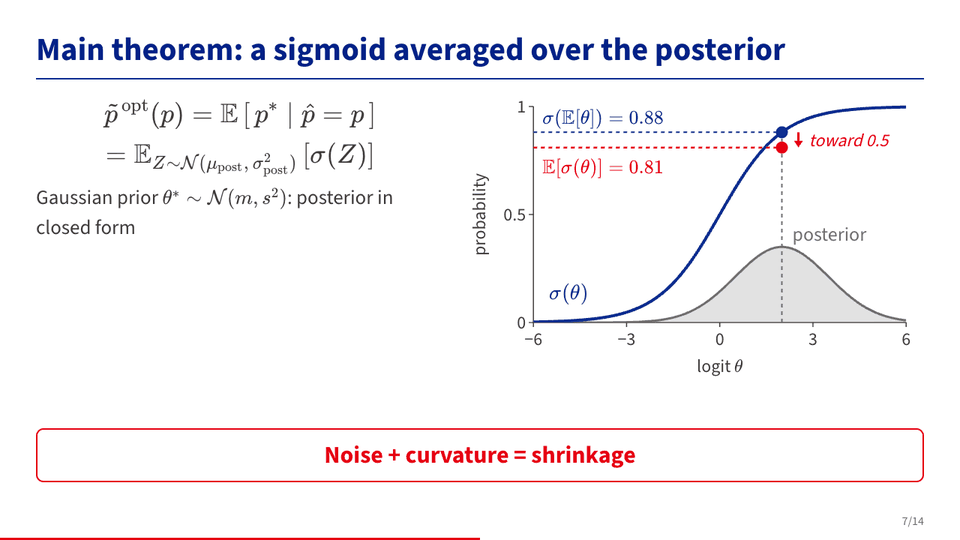

## できること

- **段階表示**：`data-step="k"` で話す順に出す。結論の行（`.concl`）は自動で最後
- **数式**：KaTeX でビルド時に組む。`\hlE{…}` `\hlT{…}` `\hlM{…}` で式の一部にテーマの色を付ける
- **動く図**：Web Components の部品（`components/`：`m-sweep` `m-curves` `m-flow` `m-collect` `m-seq`、ビジネス・ピッチ向けの `m-bars` `m-quad` `m-market` `m-kpi`。`m-flow` はお金とサービスの流れも描く）。画面は (スライド, 段階, 時刻) だけで決まるので、そのままコマ単位で動画に書き出せる
- **スライドへのリンク**：ふつうの `<a href="#<スライドの id>">`（か `#<スライドの id>:<段階>`）でそのスライドか段階へ飛び、**戻る**（ボタン・Backspace・Alt+←・ブラウザの戻る）で戻れる。`m-menu` はそのリンクを札の格子に並べる（目次・選ぶ 1 枚）。スクリプトのないふつうのリンクなので、持ち運べる 1 ファイルは Core のまま。[contract §9](docs/contract.ja.md#9-スライドへのリンク)
- **国語**：縦書き（`.tate`）・ルビ・明朝（BIZ UDP明朝）・テーマ `kokugo`。`m-kanbun`（白文 → 返り点と送り仮名 → 読む順を 1 字ずつたどる → 書き下し文）、`m-kobun`（1 文ずつの品詞分解・押すと出る助動詞の活用表・現代語訳）、`m-gendai`（傍線・指示語から指す内容への矢印・段落の役割）。[参照](docs/reference.ja.md#国語kokugo)
- **注目の演出**：口述原稿に `{mark:ID|circle}` と書くと、その言葉のところでスライドに手描きの下線・囲み・枠・スポット・レーザーの点が出る
- **モーフ**：`data-morph` のスライドでは、前のスライドの式や要素が今の位置へ滑ってくる（Keynote のマジックムーブ）
- **1 つの原稿で 3 つのモード**：発表（`?mode=talk`）、授業（`?mode=lecture`：全部見せて今の段階を強調）、動画（`?mode=video`）
- **発表の道具**：発表者ビュー（口述原稿がカンペになる・タイマー）、スライド一覧、レーザー、ペン、消えるペン、操作の帯
- **テーマ**：基調色 1 つで切り替える（`themes/<名前>/tokens.css`）。部品はテーマの変数だけを使う
- **検査**：`kit/check.mjs` がはみ出し・文字の大きさ・段階・口述原稿の抜け・配色のコントラスト・部品の再現性・注目の演出・モーフを調べる
- **開発サーバー**：ブラウザの上で文言と口述原稿を直し、Claude Code への指示を残せる
- **持ち運べる 1 ファイル**：`--portable` で、オフラインで再生でき、原稿と音声も中に持つ 1 つの HTML を書く。デッキのフォルダに戻せる（`npm run portable -- unpack|pack`）。`--play-only` は原稿を入れない写し。持ち運べるデッキの公開の形式 **Egatari（絵語り）**（[仕様](https://github.com/egatari/egatari-spec)、1.0 の草案）に従う。[参照](docs/reference.ja.md#持ち運べる-1-ファイル--portable)
- **出力**：単一の HTML（字・数式と、原稿が参照するローカルの画像・動画・CSS を埋め込み済み、オフラインで開ける）。印刷か `tools/pdf.mjs` で PDF

**リファレンス**：選択肢・記法・キー・環境変数をすべて 1 ページに：[docs/reference.ja.md](docs/reference.ja.md)

| 注目の演出 | モーフ（前・途中・後） |
|---|---|
| 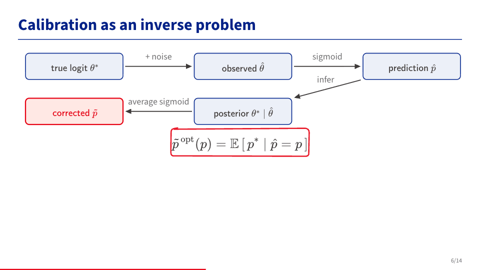 | 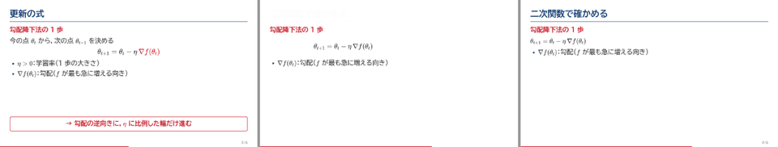 |

| 発表者ビュー | スライド一覧 |
|---|---|
| 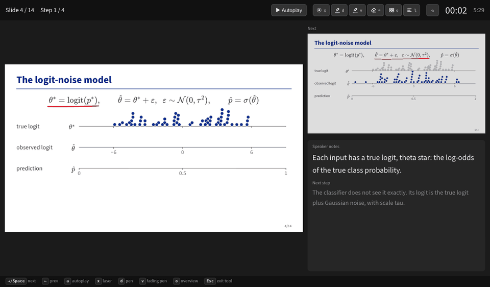 | 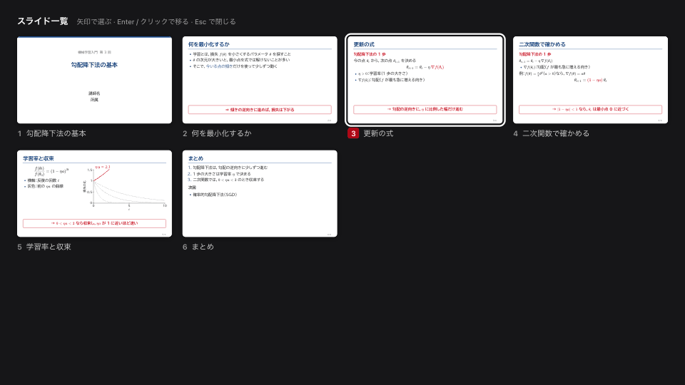 |

## 2 つの使い方

| | 段階 1：スライド（中心） | 段階 2：読み上げ付きの動画（任意） |
|---|---|---|
| できるもの | HTML のデッキ、発表者ビュー、授業モード、PDF | 段階ごとの MP4、全体の動画、教材のバンドル |
| 要るもの | Node 22 以上。Google Chrome は検査・PDF・テストにだけ使う | 段階 1 のもの＋ffmpeg・uv・TTS のサーバー・参照音声 |
| あると良いもの | uv（字の絞り込み） | |

**スライドは TTS なしで全部使える。** 段階 1 のコマンドは `tts/` と `render/` から何も読み込まない。`audio/` や `voice.json` がなくても build・check・開発サーバーは動く。音声がなければ、自動再生（`a`）は各段階の既定の長さで進み、口述原稿は発表者ビューにカンペとして出る。

## 要るもの

**段階 1（スライド）**

- [Node.js](https://nodejs.org/) 22 以上
- Google Chrome か Microsoft Edge：`kit/check.mjs`・`tools/pdf.mjs`・スクリーンショット・テストで使う（`playwright-core` で Chrome、なければ Edge を探す）。組むことと発表には、ファイルを開くブラウザがあればよい。どちらもなければ `npx playwright-core install chromium` を実行する（Playwright の Chromium を代わりに使う）か、`CHROME_PATH=/path/to/chrome-or-chromium` を指定する
- あると良い：[uv](https://docs.astral.sh/uv/)。`node tools/get-fonts.mjs` で BIZ UDPゴシック（と BIZ UDP明朝）の TTF を取ってくると、build が uv で `pyftsubset` を動かし、使っている字だけを埋め込む。TTF（または uv）がなければ `@fontsource` の分割ファイル（WOFF2）のうち使う字を含むものを埋め込む。ファイルは大きくなるが見た目は同じ

**Windows**

入れたばかりの Windows には Node.js も Git もない。PowerShell で：

```powershell
winget install OpenJS.NodeJS.LTS Git.Git     # 入れたら端末を開き直す
winget install astral-sh.uv Gyan.FFmpeg      # 任意：uv（字を小さくする）・ffmpeg（動画）
```

Edge は最初からあるので、Chrome がなくても検査と PDF は動く。下のコマンドは PowerShell か Git Bash で打つ（`open` は `start` に読み替える）。Git がなければ GitHub から ZIP を落とす（Code → Download ZIP）。読み上げ音声を作る（段階 2）には TTS のサーバーが要る。確かめている mlx-audio は Apple silicon の Mac でしか動かない。

**ブラウザ**

- 組んだ HTML の発表：Chrome/Edge 119 以上、Firefox 128 以上、Safari 18 以上（テーマが `--base` から淡色などを導くのに使う CSS の相対色の記法と `color-mix()` に対応しているもの）。それより古いブラウザでも表示はできるが、色はテーマの `--base` から導いたものではなく、既定のテーマから計算した固定の予備の色になる
- PDF（`tools/pdf.mjs`）・動画（`render/`）・`kit/check.mjs`・テストは Google Chrome（または Playwright の Chromium）だけで作り、確かめている（Edge も同じエンジン）

**段階 2（動画）**

- ffmpeg と ffprobe（`PATH` に置く）
- uv（`tts/` の小さな Python プロジェクトを動かす）
- OpenAI 互換の音声合成 API を持つ TTS のサーバー。たとえば [mlx-audio](https://github.com/Blaizzy/mlx-audio) で `mlx-community/Irodori-TTS-v4.1-Small-fp16`（日本語）か `mlx-community/VoxCPM2-8bit`（英語など）を動かす。場所は `IRODORI_URL`（既定 `http://localhost:8882`）
- 参照音声：既定の声 `bob` と `alice`（合成した声。日本語と英語）は `tts/voices/` に入っている（[詳しく](tts/voices/README.md)）。自分の声は `<名前>.wav` としてそこ（git 管理外）か `IRODORI_REF_DIR` に置く

## はじめ方（段階 1：スライド）

```bash
git clone https://github.com/egatari/egatari-studio.git
cd egatari-studio
npm ci
node tools/get-fonts.mjs                            # 任意：埋め込む字を小さくする（build で uv を使う）

node kit/build.mjs examples/minimal/deck.html       # → examples/minimal/out/deck.html
open examples/minimal/out/deck.html                 # macOS。ほかの OS ではファイルをブラウザで開く

node kit/check.mjs examples/minimal/deck.html       # 検査。最後の行が「エラー 0」になる
node tools/pdf.mjs examples/minimal/out/deck.html examples/minimal/out/deck.pdf   # PDF（1 スライド 1 ページ）
node server/dev.mjs examples/minimal/deck.html      # 開発サーバー http://127.0.0.1:8730/（Ctrl+C で止める）
```

### 自分のデッキを作る

```bash
npm run new -- talks/mytalk --theme default --title "発表の題名"
npm run build -- talks/mytalk/deck.html    # -> talks/mytalk/out/deck.html
npm run dev -- talks/mytalk/deck.html      # ブラウザで直す
npm run check -- talks/mytalk/deck.html    # 最後の行が「エラー 0」になればよい
```

`npm run new -- <フォルダ>` は、きれいな雛形から `deck.html` と `narration.md` を作る（表紙と、段階・数式・注目の演出・部品の見本のスライド。口述原稿は全段階ぶん）。選択肢は `--lang en|ja`（既定 `ja`）、`--theme <名前>`（既定 `default`）、`--title "…"`。空でないフォルダには書かない。テーマは後から `<html data-theme="tml">` か `--theme tml` で変えられる。`<html lang="en">` のデッキは本文の字が Source Sans 3 になり、検査も英語の規則になる。もっと作り込んだ見本は `examples/minimal/`。

新しいデッキのスライドにはどれも変わらない id（`<section class="slide" id="s-k3f9q2">`）があり、口述原稿の見出しがそれを指す（`## 見出し {#s-k3f9q2}`）。見出しを直しても、口述原稿・音声・秒数の対応は崩れない。id のない頃に作ったデッキは、一度 `npm run ids -- talks/mytalk` を打つ：id を付け、`narration.md`・`audio/manifest.json`・`timeline.json`・`comments.json` の鍵を付け替える（控えは `.cache/edits/`）。

## ブラウザで直す（開発サーバー）

`deck.html` を手で開いて書き換える必要はほとんどない。開発サーバーを起動して、スライドの上で直す。

```bash
node server/dev.mjs path/to/deck.html            # http://127.0.0.1:8730/ を開く（Ctrl+C で止める）
```

画面はいつもの発表画面（矢印・`p`・`a` などはそのまま使える）で、編集の道具はその外側に出る。デッキは sandbox の枠の中で動き、「どこを直したいか」を知らせることしかできず、編集の道具で「保存」を押すまで何も書き込まれない。デッキのファイルが変わると自動で読み込み直し、スライドと段階はそのまま残る。

1. **文字を直す：`e` → ダブルクリック。** 直せる要素に点線の枠が出る。ダブルクリックでその部分の原稿（HTML と `\( … \)` の式）が開くので、直して ⌘/Ctrl+Enter。`deck.html` のその要素だけが書き換わる
2. **口述原稿を直す：`n`。** 右に今の段階の口述原稿が出る。直して保存（発言の追加・削除・話者の変更もできる）。`narration.md` のその段階だけが書き換わる
3. **Claude Code に頼む：Alt+クリック（Mac は ⌥ option キーを押したままクリック）。** 直してほしいことを書く（「この図を大きく」「このスライドを 2 枚に分けて」）。指示は `comments.json` に貯まり、`c` で一覧。Claude Code に「コメントを反映して」と頼むと直し、保存した時点で画面に出る
4. **元に戻す：** 書き換える前の `deck.html`・`narration.md` は `.cache/edits/` に残る（新しい 30 個）

| `e`＋ダブルクリック：原稿を直す | `n`：口述原稿を直す | Alt / ⌥ option+クリック：Claude Code への指示 |
|---|---|---|
| 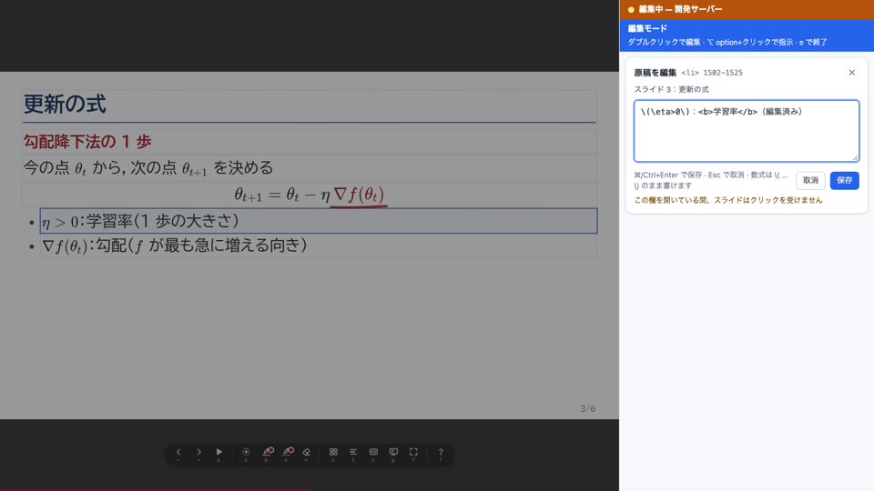 | 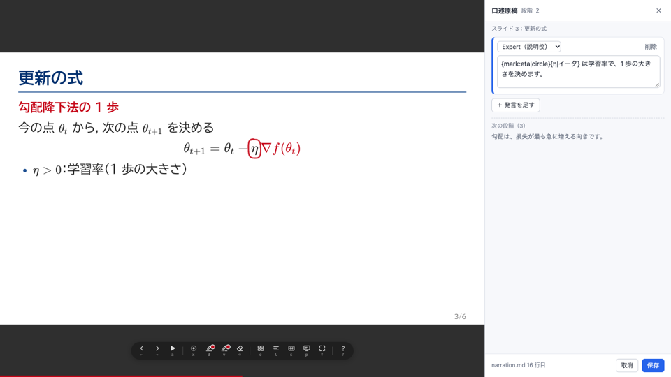 | 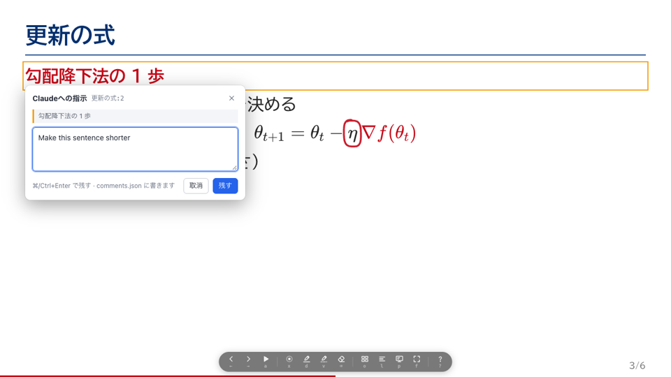 |

詳しくは [docs/dev-server.ja.md](docs/dev-server.ja.md)（[English](docs/dev-server.md)）。

## 編集アプリ（インストール不要）

開発サーバーと同じ編集を、デッキのフォルダを直接開くウェブページでできる。Node もターミナルも要らない。**パソコンの Google Chrome か Microsoft Edge** が要る（File System Access API を使う。Safari と Firefox にはない）。

- **開く：** Chrome か Edge で **<https://editor.egatari.org/>** を開く（インストール不要）。または `npm run build:app` で組み、`dist/editor.html`（1 ファイル、約 10 MB）をダブルクリックで開く
- **デッキを開く：** デッキのフォルダ（`deck.html` の入ったもの）を画面に落とすか「フォルダを開く」を押し、そのフォルダの編集を許可する。「新しいデッキ」は `npm run new` と同じ雛形から `deck.html` と `narration.md` を作る。最近開いたフォルダは最初の画面に並ぶ
- **直す：** 開発サーバーと同じキー。`e`＋ダブルクリックで原稿、`n` で口述原稿、Alt / ⌥ option＋クリックで Claude への指示（`comments.json`）、`c` で一覧。控えはフォルダの `.cache/edits/` に残る
- **持ち運べる 1 ファイルをフォルダなしで：** 「ファイルを開く…」（またはファイルを落とす）で[持ち運べる 1 ファイル](docs/reference.ja.md#持ち運べる-1-ファイル--portable)を開き、メモリの上で直す。ファイルは動かさずに Worker の中で取り出す。「保存」で同じファイルに（またはダウンロード）、「新しい教材として保存…」で元の教材を記録した新しい識別子の教材に、「フォルダに書き出す…」で空のフォルダに原稿と音声を出す。教材の識別子と権利の表示は残し、最初の編集の前にライセンスを見せる（改変を認めないライセンスは確認つき）。口述原稿・音声・秒数の編集は組み直さずに保存し、ファイルのその所だけが変わる。スライドを直したら、編集していないスライドの見え方が変わりうると知らせてから組み直す。フォルダを開いているときは「1 ファイル（持ち運べる形）を書き出す」。今のどのブラウザでも使える（ファイルを選ぶ画面がなければ保存はダウンロード）
- **Claude Code と一緒に：** ほかのもの（Claude Code・テキストエディタ）がファイルを変えると、2 秒ほどで気づいて組み直し、同じスライド・段階のまま表示する。組み立てに失敗したら、直るまでプレビューの上にエラーを出す
- **言語：** ふだんはブラウザの言語に合わせる。右上の **English / 日本語** のボタン（または `?lang=en`・`?lang=ja`）で切り替える
- **道具の列：** 簡易チェック、1 つの HTML に書き出す、印刷 / PDF、発表者ビュー（口述原稿と次の段階が出る窓）、全画面

できないこと：読み上げ音声（TTS）・動画・`npm run check`（全部の検査）・`tools/pdf.mjs` はコマンドで行い、フォルダの音声は鳴らない。簡易チェックは一部の検査（はみ出し・文字の大きさ・字数・口述原稿の抜け・コントラスト）で、目安にとどまる（全部は `npm run check`）。書き出す HTML は字を絞り込まず分割ファイルごと埋め込む（ブラウザに fonttools がない）ので、コマンドで組んだものより大きい（`examples/minimal` で 0.7 MB に対して約 2 MB）。リポジトリの部品とテーマはアプリを組んだときのもの。デッキのフォルダの中の部品・テーマはフォルダから読む。

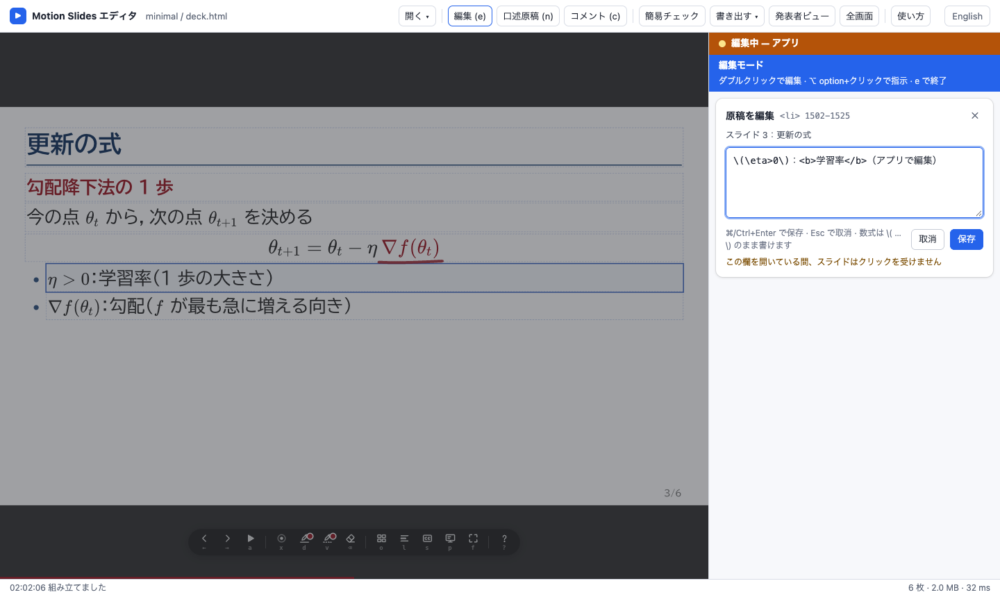

詳しくは [docs/editor.ja.md](docs/editor.ja.md)（[English](docs/editor.md)）。

## Claude Code で使う

スキルを Claude Code のスキルのフォルダにリンクする。スキルはリンク先の実体の場所からリポジトリを探すので、clone した場所は動かさない。

```bash
mkdir -p ~/.claude/skills
ln -s "$PWD/skills/motion-slides"       ~/.claude/skills/
ln -s "$PWD/skills/motion-slides-video" ~/.claude/skills/
ln -s "$PWD/skills/motion-components"   ~/.claude/skills/
```

Windows では、代わりにジャンクションを作る（clone したフォルダで PowerShell から。管理者の権限も開発者モードも要らない）：

```powershell
New-Item -ItemType Directory -Force "$HOME\.claude\skills" | Out-Null
foreach ($s in "motion-slides", "motion-slides-video", "motion-components") {
  New-Item -ItemType Junction -Path "$HOME\.claude\skills\$s" -Target "$PWD\skills\$s"
}
```

| スキル | 使いどころ |
|---|---|
| `motion-slides` | 構成案・原稿・段階・口述原稿・検査・build（段階 1） |
| `motion-slides-video` | TTS・動画の書き出し・バンドル（段階 2） |
| `motion-components` | 動く図の部品を新しく書く、部品庫に移す |

頼み方の例：

- 「`paper/main.tex` から 10 分の発表の HTML スライドを motion-slides で作って。テーマは default、1 人で話す」
- 「学習率で損失の下がり方が変わる様子を m-sweep で見せるスライドを足して」
- 「コメントを反映して」（開発サーバーで Alt / ⌥ option+クリックの指示を残した後。Claude は `comments.json` を読む）
- 「`talks/intro` を motion-slides-video で読み上げ付きの動画にして」

スキルはまず構成案を見せ、承認を得てから HTML を書く。

## 動画にする（段階 2）

```bash
D=examples/minimal
uv run --project tts python tts/synth.py $D --dry-run    # 無音の仮の音声（オフラインで流れを試す）
uv run --project tts python tts/synth.py $D              # 本番の TTS（サーバーと参照音声が要る）
node kit/build.mjs $D/deck.html                          # 組み直して、音声の長さをタイムラインに入れる
node render/render.mjs $D/out/deck.html --out $D/video   # 1 段階だけなら --only "更新の式:2"、1 本にまとめるなら --full
node render/export-canon.mjs $D --render $D/video --out $D/bundle
```

- 声：`--voices expert=bob,novice=alice` か `<デッキ>/voice.json`（`{"expert": "me"}`、または wav のパス）。既定は 1 人なら `bob`、掛け合いなら `bob`（Expert）と `alice`（Novice）で、`tts/voices/<名前>.wav` を探す。英語のデッキでは `<名前>_en.wav` があればそちらを使う
- サーバーが動いていない、参照音声がないときは、`synth.py` がその URL やファイルを示して止まる
- `export-canon.mjs` は教材のバンドル（Marp 形式の md と、段階ごとの MP4・PNG）を作る。canon は TML 研究室の講義配信システムだが、同じ形式を受け付けるほかのシステムにも使える。`CANON_DIR` があれば canon 自身の parser でも確かめ、なければその検査を飛ばす
- **音声入りの HTML**：`node kit/build.mjs $D/deck.html --embed-audio` で口述原稿の音声を HTML の中に入れる。1 つのファイルだけで、どこでも `a`（自動再生）で音声付きで進む。音声は AAC（64 kbps・モノラル）に圧縮する（5 分で約 4.5 MB。WAV のままだと約 30 MB）。今の主要なブラウザはすべて再生できる。`--embed-audio` を付けなければ、HTML は `audio/` の WAV を参照するだけで変換しない。ffmpeg がなければ WAV のまま埋め込み、build が警告する
- 詳しく（キャッシュ、`timeline.json` での長さの調整、読み辞書）：[docs/video.ja.md](docs/video.ja.md)（[English](docs/video.md)）

## 操作（発表）

| キー | すること |
|---|---|
| → / Space、← | 次の段階 / 前の段階 |
| Shift+→ / Shift+← | 次のスライド / 前のスライド |
| 数字＋Enter | そのページへ |
| f | 全画面 |
| p | 発表者ビュー（カンペ・次の段階・タイマー） |
| a | 自動再生（音声があれば流す） |
| l | 授業モード |
| b | 暗転 |
| s / Shift+s | 字幕（口述原稿を 2 行ほどずつ）/ 字幕の大きさ S・M・L |
| o | スライド一覧（矢印で選んで Enter） |
| x / d / v | レーザー / ペン / 消えるペン。Shift+d（または操作の帯の色のボタン）でペンの色 |
| Backspace（Shift+Backspace） | ペンを使っている間：このスライドの書き込みを消す（全部消す） |
| Esc | 道具を解除 |
| ? | キーの一覧 |

すべてのキー（Home/End、PageUp/PageDown、発表者ビューのキー）と URL の引数は [docs/reference.ja.md#発表](docs/reference.ja.md#発表)。

マウスを動かすと、同じ操作のボタンを並べた帯が出る（2.5 秒止まると隠れる）。ペンの線はスライドごとに残り、印刷と動画には出ない。

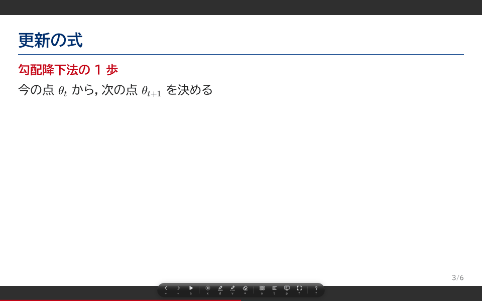

## テーマ

テーマは `themes/<名前>/` のフォルダで、中身は次の 2 つ。

- `tokens.css`：CSS の変数。ふつうは基調色 `--base` だけを書く。ほかの色（`--term` `--emph` `--muted` `--title`、淡色、`--series-*`）は `themes/default/tokens.css` が基調色から導く。どれも上書きできる
- `theme.json`（任意）：`{"name": "mylab", "extends": "default", "logos": ["logos/cover.png"]}`。ロゴは表紙に出る

```bash
mkdir -p themes/mylab
printf ':root{ --base: #006d5b; }\n' > themes/mylab/tokens.css
printf '{"name": "mylab", "extends": "default"}\n' > themes/mylab/theme.json
node kit/build.mjs examples/minimal/deck.html --theme mylab
```

テーマはデッキの隣（`<デッキ>/themes/<名前>/`）にも置ける。同梱：`default`（中立）、`business`（中立。ビジネス・ピッチ向けの紺と橙、ロゴなし）、`kokugo`（明朝。国語向け）と、機関のテーマ `tml` `tcue` `wsd` `ohte`（大学のロゴを含む。ライセンスの節を参照）。

## 見本

| 見本 | 内容 |
|---|---|
| [`examples/minimal`](examples/minimal) | 日本語・6 枚（勾配降下法）。段階、KaTeX と `\hlE`、`{mark}`、`data-morph`、`m-sweep`、全段階の口述原稿。作り込んだ見本（新しいデッキの雛形は `npm run new` で作る） |
| [`examples/tmlr2026-calibration`](examples/tmlr2026-calibration) | 英語・14 枚（TMLR 2026 の論文の紹介）。デッキ専用の部品（`components/`）、スクリプトで作ったデータ（`scripts/` `data/`）、英語の TTS（`voice.json`）、テーマ `tml` |
| [`examples/pitch-fictional`](examples/pitch-fictional) | 日本語・10 枚（架空の会社「株式会社レポミル」（報告書の下書きを作る SaaS）のピッチ）。`m-kpi`、`m-flow`（お金の流れと `pulse`）、`m-bars`（軸の広がり）、`m-quad`、`m-market`、テーマ `business`、スクリプトで書いたデータ（`scripts/` `data/`）。社名・製品・数字はすべて架空 |
| [`examples/kokugo-kanbun`](examples/kokugo-kanbun) | 日本語・11 枚（国語の授業）。`m-menu` の目次（各部へのリンクと「戻る」）、`m-kanbun` の漢文（『史記』、孟浩然「春暁」、杜甫「春望」、『論語』）、`m-kobun` の『枕草子』、`m-gendai` の現代文（見本のために書いた文章、縦書き）、テーマ `kokugo` |

`examples/tmlr2026-calibration` の `voice.json` は TTS の既定の声を使う。公開しているこの見本の動画は、著者本人の参照音声で読み上げたもの（参照音声はリポジトリに含めていない）。

`examples/minimal`：

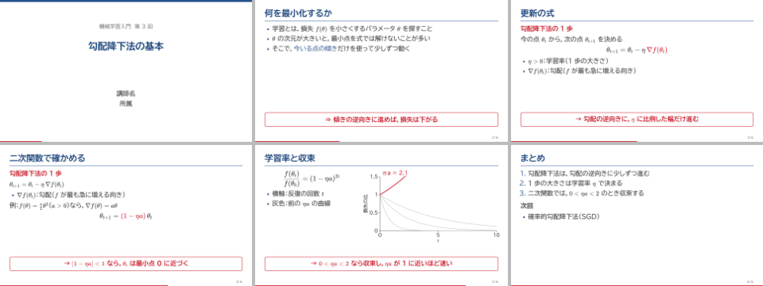

`examples/tmlr2026-calibration`：

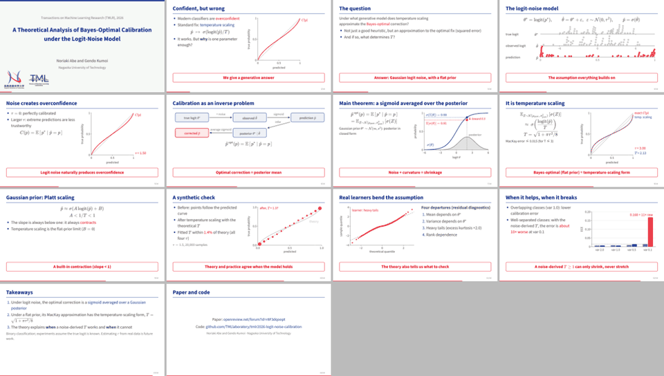

`examples/kokugo-kanbun`（「春暁」の読む順。一二点で、目が鳥から聞へ戻るところ）：

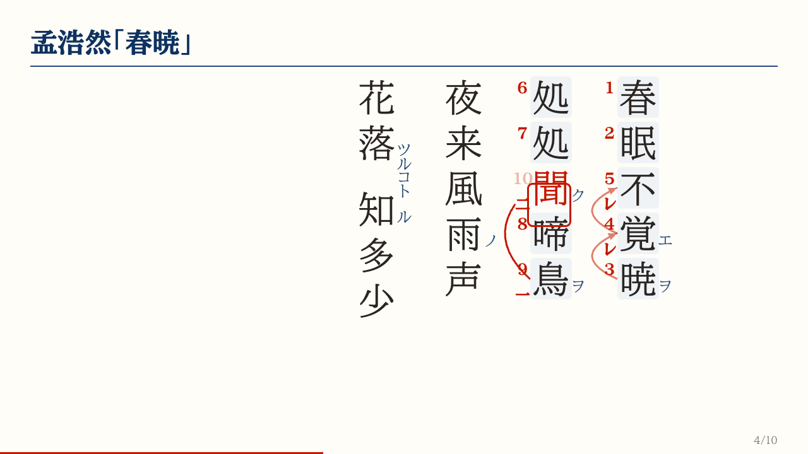

## 構成

| 場所 | 中身 |
|---|---|
| `docs/contract.ja.md` | 約束事（位置と時刻、部品、口述原稿、タイムライン、注目の演出、モーフ）。**まずここを読む**（[English](docs/contract.md)） |
| `docs/dev-server.ja.md`、`docs/editor.ja.md`、`docs/video.ja.md` | 手引き：開発サーバー、編集アプリ、動画にする（[English](docs/dev-server.md)、[English](docs/editor.md)、[English](docs/video.md)） |
| `docs/reference.ja.md` | リファレンス：原稿の記法、口述原稿、長さ、テーマ、キー、URL の引数、すべてのコマンドの選択肢と環境変数（[English](docs/reference.md)） |
| `kit/` | 実行系（`deck.js` `presenter.js` `tools.js`）、体裁、ビルド、口述原稿の解析、検査、ブラウザの起動。`kit/core/` は Node と編集アプリが共有する組み立ての本体、`kit/templates/` は新しいデッキの雛形 |
| `components/` | 動く図の部品。一覧は `components/CATALOG.md` |
| `themes/` | テーマ |
| `server/` | 開発サーバーとブラウザ上の編集 |
| `app/` | 編集アプリ（インストール不要）の元。`npm run build:app` で `dist/` に配信版（`dist/index.html`）と 1 ファイルの `dist/editor.html` を作る |
| `tts/` `render/` | 段階 2：TTS（uv のプロジェクト）、動画の書き出し、バンドルの出力 |
| `skills/` | Claude Code のスキル |
| `tools/` | 新しいデッキの雛形（`new.mjs`）、テストと補助（`smoke` `test-*` `shot` `pdf` `get-fonts.mjs`） |
| `CHANGELOG.md` | 版ごとの変更（英語） |

テスト（Chrome が要る）：

```bash
node kit/build.mjs examples/minimal/deck.html
node tools/smoke.mjs examples/minimal/out/deck.html /tmp/smoke     # タイムラインとスクリーンショット
node tools/test-components.mjs
node tools/test-tools.mjs examples/minimal/out/deck.html
node tools/test-controls.mjs examples/minimal/out/deck.html
node tools/test-links.mjs                                          # スライドへのリンク・戻る・埋め込み・m-menu・検査器
node tools/test-dev-server.mjs
node tools/test-app.mjs                                            # 編集アプリ（一時フォルダに dist/ を組む）
```

## フィードバックと貢献

- デッキで `?` を押し、「**フィードバックを送る**」を押す（発表者ビューにもある）。版・ブラウザ・OS・言語・モードだけを入れた [フィードバックの form](https://github.com/egatari/egatari-studio/issues/new?template=feedback.yml) が開く。スライドの中身は送らない。`<html data-feedback="off">` で消せる
- Claude Code では「感想を送って」と言う。スキルが作業中に困ったことを issue の下書きにまとめ、確認を取ってから作る
- 新しい図が欲しいときは [部品の依頼](https://github.com/egatari/egatari-studio/issues/new?template=component-request.yml)。デッキの中で書いた部品は [部品の提案](https://github.com/egatari/egatari-studio/issues/new?template=component-submission.yml) から
- 質問は [Discussions](https://github.com/egatari/egatari-studio/discussions) へ。貢献の仕方は [CONTRIBUTING.ja.md](CONTRIBUTING.ja.md)
- 版ごとの変更は [CHANGELOG.md](CHANGELOG.md)（英語）

## セキュリティ

デッキはコードとして扱う：原稿のスクリプトと部品は、ブラウザと、検査器・書き出しが使う headless Chrome の中で動き、build は原稿のフォルダの中のローカルのファイルを読む。信頼できるデッキだけを組み、開発サーバーで開くこと。信頼の前提と脆弱性の報告のしかた：[SECURITY.md](SECURITY.md)。

## ライセンス

- コード：[MIT](LICENSE)、Copyright (c) 2026 Gendo Kumoi。フォント・KaTeX のフォント・ロゴは [NOTICE](NOTICE) を参照
- 字：BIZ UDPゴシック・BIZ UDP明朝・Source Sans 3 は SIL Open Font License 1.1（BIZ UDPゴシックは [fonts/OFL.txt](fonts/OFL.txt)、BIZ UDP明朝は [fonts/OFL-BIZUDPMincho.txt](fonts/OFL-BIZUDPMincho.txt)、`@fontsource` のパッケージにはそれぞれのライセンスのファイルがある）。組んだデッキはこれらの一部を埋め込む。KaTeX とその字は MIT
- `themes/tml` `themes/tcue` `themes/wsd` `themes/ohte` の大学のロゴは各機関のもので、MIT ライセンスの対象外
