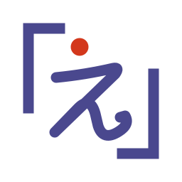

<!-- i18n: pair=README.ja.md sha256=0d77296d6fbf65e5 -->
<p align="center">
  <picture>
    <source media="(prefers-color-scheme: dark)" srcset="assets/logo/egatari-dark.svg">
    
  </picture>
</p>

# Egatari Studio

[](https://github.com/egatari/egatari-studio/actions/workflows/test.yml)

English | [日本語](README.ja.md)

*Egatari Studio (formerly motion-academic-slides). The npm package, the skills and the commands keep their names.*

Academic slides as one self-contained HTML file, with step-by-step reveals and parts that follow the order of your explanation. One set of slides and script (`deck.html` + `narration.md`) gives you a live talk (with later steps shown faintly if you like), a PDF, and, optionally, a narrated video made with TTS. It is designed to be driven by [Claude Code](https://claude.com/claude-code) through the skills in `skills/`, but every step is a plain Node command and works without it.


## Features

- **Steps**: `data-step="k"` shows content in the order you speak. The conclusion line (`.concl`) always comes last
- **Math**: KaTeX, rendered at build time. `\hlE{…}` / `\hlT{…}` / `\hlM{…}` color a term using the theme
- **Parts**: Web Components from [egatari/components](https://github.com/egatari/components) (vendored in `vendor/components/`: `m-sweep`, `m-curves`, `m-flow`, `m-collect`, `m-seq`, and for business and pitch lessons `m-bars`, `m-quad`, `m-market`, `m-kpi`, and for coding lectures `m-codetree` (decoding a bit string with a code tree); `m-flow` also draws money and service flows). The screen depends only on (slide, step, time), so the same lesson can be exported frame by frame to video
- **Links to slides**: an ordinary `<a href="#<slide id>">` (or `#<slide id>:<step>`) jumps to that slide or step and offers **Back** (button, Backspace, Alt+←, browser back); `m-menu` lays such links out as a grid of cards for a contents or choice slide. Plain anchors, no script, so an Egatari file (`.ega.html`) stays Core. See [contract §9](docs/contract.md#9-links-to-slides)
- **Japanese language arts (国語)**: vertical writing (`.tate`), ruby, a Mincho font (BIZ UDPMincho) and theme `kokugo`; `m-kanbun` (白文 → 返り点 and 送り仮名 → the reading order traced character by character → 書き下し文), `m-kobun` (品詞分解 sentence by sentence, auxiliary-verb conjugation cards, modern translation), `m-gendai` (side lines, demonstrative → referent arrows, paragraph roles). See [reference](docs/reference.md#japanese-language-arts-kokugo)
- **Emphasis**: `{mark:ID|circle}` in the script draws a hand-drawn underline, circle, box, spotlight or laser pointer dot on the slide at that word
- **Morph transitions**: `data-morph` slides an equation or element from its place on the previous slide to its new place (like Keynote's Magic Move)
- **Two modes from one source**: slide show (`?mode=talk`) and video (`?mode=video`). Show later steps faintly is an option of the slide show (`l`; `?mode=lecture` opens it with the option on)
- **Presenter tools**: presenter view with speaker notes and timer, slide overview, laser pointer, pen, fading pen, toolbar
- **Themes**: one base color per theme (`themes/<name>/tokens.css`). Parts only use theme variables
- **Quality control**: the standards (R-fit, R-steps, …) say what a lesson must meet; the quality checker `kit/check.mjs` (`npm run check`) reports overflow, text size, steps, script coverage, contrast, part determinism, emphasis and morphs
- **Dev server**: edit text and the script in the browser, leave comments for your AI coding tool
- **Egatari file (`.ega.html`)**: `--portable` writes one HTML file (at the top of the lesson folder, named from the lesson title; the path is printed) that plays offline and also carries its source and audio, so it can be unpacked back into a working folder (`npm run portable -- unpack|pack`); `--play-only` writes a copy without the editable slides and script. It follows **Egatari** (絵語り, “narrating with pictures”), an open [format for Egatari files](https://github.com/egatari/egatari-spec) (draft 1.0). See [reference](docs/reference.md#single-file---portable)
- **Output**: one self-contained HTML file (fonts, math, and local images, videos and stylesheets referenced by the slides embedded; works offline). Print to PDF from the browser or with `tools/pdf.mjs`

**Reference**: every option, syntax, key and environment variable on one page: [docs/reference.md](docs/reference.md)

| Emphasis | Morph (before / during / after) |
|---|---|
|  |  |

| Presenter view | Slide overview |
|---|---|
|  |  |

## Two ways to use it

| | Tier 1: slides (core) | Tier 2: narrated video (optional) |
|---|---|---|
| You get | HTML slides, presenter view, the option to show later steps faintly, PDF | per-step MP4 clips, a full video, an Egatari file with audio |
| Needs | Node ≥ 22; Google Chrome only for the quality checker, PDF and tests | everything in tier 1, plus ffmpeg, uv, a TTS server and reference voices |
| Optional | uv (font subsetting) | |

**Slides are fully usable without TTS.** No tier-1 command imports anything from `tts/` or `render/`, and `build`, `check` and the dev server work when `audio/` and `voice.json` are absent. Without audio, autoplay (`a`) uses the default timing for each step, and the script still shows in the presenter view as speaker notes.

## Requirements

**Tier 1 (slides)**

- [Node.js](https://nodejs.org/) 22 or newer, a release with the latest security fixes (see [SECURITY.md](SECURITY.md))
- Google Chrome or Microsoft Edge for `kit/check.mjs`, `tools/pdf.mjs`, screenshots and tests (through `playwright-core`: Chrome first, then Edge). Building and presenting only need a browser to open the file. Without either, run `npx playwright-core install chromium` (the tools then fall back to Playwright's Chromium) or set `CHROME_PATH=/path/to/chrome-or-chromium`
- Optional: [uv](https://docs.astral.sh/uv/). After `node tools/get-fonts.mjs` downloads the BIZ UDPGothic (and BIZ UDPMincho) TTF files, the build uses uv to run `pyftsubset` and embeds only the glyphs you use. Without the TTF files (or without uv) it embeds the matching `@fontsource` WOFF2 subsets instead. Those files are larger but look the same

**Windows**

A fresh Windows has neither Node.js nor Git. In PowerShell:

```powershell
winget install OpenJS.NodeJS.LTS Git.Git     # then open a new terminal
winget install astral-sh.uv Gyan.FFmpeg      # optional: uv (smaller fonts), ffmpeg (video)
```

Edge is already there, so the quality checker and PDF work without Chrome. Run the commands below in PowerShell or Git Bash; replace `open` with `start`. Without Git, download the ZIP from GitHub (Code → Download ZIP). Making the script audio (tier 2) needs a TTS server; mlx-audio, the one we test with, runs only on a Mac with Apple silicon. On Windows, use another OpenAI-compatible TTS server, or make or record each step's audio in the editor app ([docs/video.md](docs/video.md#tts-server-mac-windows-linux)).

**Browsers**

- Presenting the built HTML: Chrome/Edge 119+, Firefox 128+ or Safari 18+ (these support the CSS relative color syntax and `color-mix()` that themes use to derive tints from `--base`). Older browsers still show the slides, with fixed fallback colors taken from the default theme instead of colors derived from the theme's `--base`
- PDF (`tools/pdf.mjs`), video (`render/`), `kit/check.mjs` and the tests are produced and tested with Google Chrome (or Playwright's Chromium) only; Edge uses the same engine

**Tier 2 (video)**

- ffmpeg and ffprobe on `PATH`
- uv (runs the small Python project in `tts/`)
- A TTS server with an OpenAI-compatible speech API, e.g. [mlx-audio](https://github.com/Blaizzy/mlx-audio) serving `mlx-community/Irodori-TTS-v4.1-Small-fp16` (Japanese) or `mlx-community/VoxCPM2-8bit` (English and others). Set `IRODORI_URL` (default `http://localhost:8882`). mlx-audio runs only on a Mac with Apple silicon; on Windows and Linux, see [other TTS servers](docs/video.md#tts-server-mac-windows-linux)
- Reference voices: the default voices `bob` and `alice` (synthetic, Japanese and English) are included in `tts/voices/` ([details](tts/voices/README.md)). Add your own as `<name>.wav` there (gitignored) or in `IRODORI_REF_DIR`

## Quick start (tier 1: slides)

```bash
git clone https://github.com/egatari/egatari-studio.git
cd egatari-studio
npm ci
node tools/get-fonts.mjs                            # optional: smaller font embedding (uses uv at build time)

node kit/build.mjs examples/minimal/deck.html       # -> examples/minimal/out/deck.html
open examples/minimal/out/deck.html                 # macOS; elsewhere, open the file in a browser

node kit/check.mjs examples/minimal/deck.html       # quality check; the last line should read "エラー 0" (0 errors)
node tools/pdf.mjs examples/minimal/out/deck.html examples/minimal/out/deck.pdf   # PDF, one page per slide
npm run sheet -- examples/minimal                        # one PNG with every slide at its final step (look at it: the check cannot see everything)
node server/dev.mjs examples/minimal/deck.html      # dev server at http://127.0.0.1:8730/ (Ctrl+C to stop)
```

### Start your own lesson

```bash
npm run new -- talks/mytalk --lang en --theme default --title "My talk"
npm run build -- talks/mytalk/deck.html    # -> talks/mytalk/out/deck.html
npm run dev -- talks/mytalk/deck.html      # edit in the browser
npm run check -- talks/mytalk/deck.html    # the last line should read "エラー 0" (0 errors)
```

`npm run new -- <folder>` creates `deck.html` and `narration.md` from a clean template: a cover and sample slides showing steps, math, emphasis and a part, with a script for every step. Options: `--lang en|ja` (default `ja`), `--theme <name>` (default `default`), `--title "…"`. It refuses to write into a folder that is not empty. You can change the theme later with `<html data-theme="business">` or `--theme business`. With `<html lang="en">` body text is set in Source Sans 3 and the quality check uses the English standards. For a fuller example, see `examples/minimal/`.

Every slide of a new lesson has a stable id (`<section class="slide" id="s-k3f9q2">`), and its script heading names it (`## Heading {#s-k3f9q2}`), so you can rename headings without breaking the script, audio or timing. For a lesson made before ids, run `npm run ids -- talks/mytalk` once: it adds ids and renames the keys in `narration.md`, `audio/manifest.json`, `timeline.json` and `comments.json` (keeping backups in `.cache/edits/`).

## Editing in the browser (dev server)

You rarely need to open `deck.html` by hand. Start the dev server and fix things on the slide itself:

```bash
node server/dev.mjs path/to/deck.html            # then open http://127.0.0.1:8730/  (Ctrl+C to stop)
```

The page shows the slides (arrow keys, `p`, `a`, … all work), with the editing tools around it: the slides run in a sandboxed frame and can only point at what to edit, and nothing is written until you press Save in the editing tools. It reloads by itself whenever a file of the slides changes, and stays on the same slide and step.

1. **Fix text: `e`, then double-click.** Editable elements get a dotted outline. Double-click one to open its source (HTML, with math as `\( … \)`), edit, and press ⌘/Ctrl+Enter. Only that element is replaced in `deck.html`.
2. **Fix the script: `n`.** A drawer shows the script of the current step. Edit the text (add or remove turns, change the speaker) and save. Only that step is replaced in `narration.md`.
3. **Leave a comment: Alt+click (on a Mac, hold ⌥ Option and click).** Write what you want changed ("make this figure larger", "split this slide"). Comments go to `comments.json`; `c` lists them. Then ask your AI coding tool (Claude Code, Codex, Gemini CLI …) to "apply the comments in comments.json" and it edits the slides; the page updates as soon as it saves.
4. **Undo:** the previous versions of `deck.html` and `narration.md` are kept in `.cache/edits/` (last 30).

| `e` + double-click: edit the source | `n`: edit the script | Alt / ⌥ Option + click: comment |
|---|---|---|
|  |  |  |

Details: [docs/dev-server.md](docs/dev-server.md) ([日本語](docs/dev-server.ja.md)).

## Editor app (no install)

The same editing as the dev server, as a web page that opens an Egatari file (`.ega.html`) or a working folder directly. Nothing to install: no Node, no terminal. An Egatari file opens and edits in any current browser; working folders need **Google Chrome or Microsoft Edge on a computer** (the File System Access API, which Safari and Firefox do not have).

| Form | What it is | Here |
|---|---|---|
| Working folder | A folder with `deck.html`, `narration.md`, `audio/` …; the commands, AI coding tools (Claude Code, Codex, Gemini CLI …) and other editors read and write it | Edit it with “Work in a folder…” (Chrome / Edge) |
| Egatari file (`.ega.html`) | One HTML file that carries its source and audio (`--portable`); open it in a browser to play | Edit it with “Open…” (any browser) |
| Play-only (`--play-only`) | An Egatari file without the editable slides and script | Cannot be edited (open the original Egatari file or the working folder) |
| Built HTML (`out/deck.html`) | The presentation output of `node kit/build.mjs` | Cannot be edited (open the working folder) |

- **Open the editor:** **<https://studio.egatari.org/>** in Chrome or Edge (nothing to install), or build it yourself with `npm run build:app` and open `dist/editor.html` (the Offline editor, about 10 MB) by double-clicking it.
- **Open an Egatari file, no folder needed:** “Open a file (.ega.html)…” on the first screen (or dropping the file) opens an [Egatari file (`.ega.html`)](docs/reference.md#single-file---portable) and edits it in memory; the file is extracted in a worker without running it. “Save” writes the same file again (or downloads it), “Save as…” writes a copy, or (ticking “Save as a new file”) a lesson under a new id that records the original, “Export working folder…” writes the source and audio to an empty folder; the lesson id and the rights notices are kept, and the license is shown before the first edit (with a confirmation for no-derivatives licenses). A script, audio or timing edit is saved without rebuilding: only those parts of the file change. A slide edit rebuilds the file, after a warning that slides you did not edit may look different. For an open folder, “Save as…” writes an Egatari file. Works in any current browser (saving downloads where there is no file picker)
- **Edit:** the same keys as the dev server: `e` + double-click for the source, `n` for the script, Alt / ⌥ Option + click for a comment (`comments.json`), `c` for the list. Backups go to `.cache/edits/` in the folder.
- **Open a working folder:** drop the working folder (the one with `deck.html`) on the page, or press “Work in a folder…”, and let the browser edit that folder. **New…** has a chat AI write a new lesson (a new working folder: `npm run new`). Recent working folders are listed on the first screen.
- **Draft with a chat AI, no coding tool needed:** “New…” asks four questions (where it is used, what it is about, how it looks, and whether your chat AI is on a free or paid plan), copies the [instructions for the AI](docs/authoring-with-llms.md) for claude.ai, Gemini or ChatGPT, and takes the AI’s output in two fields, slides and script (paste the whole output into either and it is split): the editor gives the slides ids, creates the lesson as a new Egatari file (scripts in the output ask before running, like any opened file) and runs the quality check. “Copy a fix request for your AI” in the quality check panel writes the findings, the standards they break and the current files for the same chat; “Revise…” replaces the slides from its output in the current lesson (keeping its id and audio); “Insert slide…” can have the AI add slides after the one you select
- **Script audio, one step at a time:** “Audio” plays the step's audio and marks it stale when the script changed after it was made; record a take from the microphone (with a level meter), import a file, or regenerate the step with “Make AI voice on this computer” (Irodori-TTS for Japanese with the reading dictionary, Kokoro for English; needs WebGPU, the model is downloaded once), then “Use this take”. Takes are processed like `tts/core.py` (trimmed, −20 LUFS) and saved as MP3 with where they came from ([details](docs/editor.md#script-audio-audio-panel)). In an Egatari file this is saved without rebuilding
- **Work with an AI coding tool:** when anything else changes the files (Claude Code, Codex, a text editor), the editor notices within about 2 seconds, rebuilds, and stays on the same slide and step. A build error is shown over the preview until it is fixed.
- **Language:** the editor follows your browser language; the **English / 日本語** button at the top right (or `?lang=en` / `?lang=ja`) switches it.
- **Toolbar:** File ▾ (New…, Open…, Save, Save as…, Export ▸ For participants (play-only)… / Print / PDF, File info…, Work in a folder…), Slide ▾ (Insert slide…, Duplicate, Delete, Revise…), Quality check (with a warning count), Preview ▾ (check as a slide show or as a video, show later steps faintly, or in presenter view with the script and the next step).

Limits: TTS with your own reference voices (`tts/synth.py`), video, `npm run check` (the command quality checker) and `tools/pdf.mjs` stay on the command line, and the preview does not play the folder's audio (the Audio panel does). The browser quality checker covers a subset (overflow, font size, length, missing narration, contrast) and is only a hint; the full quality check is `npm run check`. Exported HTML embeds whole font files instead of a subset (no fonttools in the browser), so it is larger than a command-line build (about 2 MB instead of 0.7 MB for `examples/minimal`). Repository parts and themes are the ones bundled when the editor was built; parts and themes inside the working folder are read from the folder.


Details: [docs/editor.md](docs/editor.md) ([日本語](docs/editor.ja.md)).

## Using it with Claude Code

Making lessons with Claude Code or Cowork (the Claude desktop app): [docs/with-claude.md](docs/with-claude.md) ([日本語](docs/with-claude.ja.md)).

Link the skills into your Claude Code skills folder. The skills find the repository from their real path, so keep the clone where it is:

```bash
mkdir -p ~/.claude/skills
ln -s "$PWD/skills/motion-slides"       ~/.claude/skills/
ln -s "$PWD/skills/motion-slides-video" ~/.claude/skills/
ln -s "$PWD/skills/motion-components"   ~/.claude/skills/
```

On Windows, use directory junctions instead (PowerShell, in the clone; no administrator rights or developer mode needed):

```powershell
New-Item -ItemType Directory -Force "$HOME\.claude\skills" | Out-Null
foreach ($s in "motion-slides", "motion-slides-video", "motion-components") {
  New-Item -ItemType Junction -Path "$HOME\.claude\skills\$s" -Target "$PWD\skills\$s"
}
```

| Skill | Use it for |
|---|---|
| `motion-slides` | plan, write, step, narrate, quality-check and build a lesson (tier 1) |
| `motion-slides-video` | TTS, render and export a lesson as video (tier 2) |
| `motion-components` | write a new part, or move one into the Parts library |

Example prompts:

- "Use motion-slides to make HTML slides from `paper/main.tex` for a 10-minute talk, default theme, single speaker."
- "Add a slide that shows how the loss changes with the learning rate, using m-sweep."
- "Apply the comments." (after leaving Alt / ⌥ Option+click comments in the dev server; the skill reads `comments.json`)
- "Turn `talks/intro` into a narrated video with motion-slides-video."

The skill first shows you an outline and writes HTML only after you approve it.

## Making a video (tier 2)

```bash
D=examples/minimal
uv run --project tts python tts/synth.py $D --dry-run    # silent placeholder audio, to try the pipeline offline
uv run --project tts python tts/synth.py $D              # real TTS (needs the server and the voices)
node kit/build.mjs $D/deck.html                          # rebuild so the audio lengths enter the timeline
node render/render.mjs $D/out/deck.html --out $D/video   # add --only "更新の式:2" for one step, --full for one file
```

- Voices: `--voices expert=bob,novice=alice`, or `<deck>/voice.json` (`{"expert": "me"}`, or a path to a wav file). The defaults are `bob` (single speaker) and `bob` / `alice` (dialogue), looked up as `tts/voices/<name>.wav`; in an English lesson `<name>_en.wav` is used when it exists
- If the server is not running or a voice file is missing, `synth.py` stops and names the URL or file it could not reach
- No Mac? `synth.py` works with any OpenAI-compatible TTS server that takes the same request ([docs/video.md](docs/video.md#tts-server-mac-windows-linux)); the editor app can also make or record each step's audio
- **Self-playing HTML with audio**: `node kit/build.mjs $D/deck.html --embed-audio` puts the script audio inside the HTML, so the HTML file plays with `a` (autoplay) anywhere. The audio is compressed to AAC (64 kbps, mono; about 4.5 MB for a 5-minute talk, instead of ~30 MB as WAV), which every current browser plays. Without `--embed-audio` the HTML refers to the WAV files in `audio/` and nothing is converted. If ffmpeg is missing, the WAV files are embedded as they are and the build warns
- Details (caching, timing overrides in `timeline.json`, the reading dictionary): [docs/video.md](docs/video.md) ([日本語](docs/video.ja.md))

## Keys (presenting)

| Key | Action |
|---|---|
| → / Space, ← | next / previous step |
| Shift+→ / Shift+← | next / previous slide |
| number + Enter | go to that page |
| f | fullscreen |
| p | presenter view (speaker notes, next step, timer) |
| a | autoplay (plays the audio if the lesson has it) |
| l | show later steps faintly (on/off) |
| b | black screen |
| s / Shift+s | captions (script, about two lines at a time) / caption size S, M, L |
| o | slide overview (arrows + Enter) |
| x / d / v | laser pointer / pen / fading pen; Shift+d (or the swatches in the toolbar) changes the pen color |
| Backspace (Shift+Backspace) | while a pen is active: clear the drawings on this slide (on all slides) |
| Esc | leave the current tool |
| ? | list of keys |

All keys (Home/End, PageUp/PageDown, presenter-view keys) and URL parameters: [docs/reference.md#presenting](docs/reference.md#presenting).

A toolbar with the same actions is shown for about 5 s when the lesson opens (the first time on a device, with a line that says how to bring it back), then whenever the mouse moves or the screen is tapped; it hides after 2.5 s. While it is hidden, a faint **Show toolbar** button at the bottom left brings it back. Drawings are kept per slide and never appear in print or video.


## Themes

A theme is a folder `themes/<name>/` with:

- `tokens.css`: CSS variables. Usually only `--base` (the base color) is needed. The other colors (`--term`, `--emph`, `--muted`, `--title`, tints, `--series-*`) are derived from it in `themes/default/tokens.css`, and you can override any of them
- `theme.json` (optional): `{"name": "mylab", "extends": "default", "logos": ["logos/cover.png"]}`. Logos appear on the cover slide

```bash
mkdir -p themes/mylab
printf ':root{ --base: #006d5b; }\n' > themes/mylab/tokens.css
printf '{"name": "mylab", "extends": "default"}\n' > themes/mylab/theme.json
node kit/build.mjs examples/minimal/deck.html --theme mylab
```

A theme can also sit next to a lesson (`<deck>/themes/<name>/`) or in a folder of your own themes: set `EGATARI_THEMES` to a list of folders (separated by `:`, or `;` on Windows), or use `~/.egatari/themes` (it may be a symbolic link). Themes are looked up in the working folder, its `themes/`, your theme folders, then the bundled `themes/` ([reference](docs/reference.md#themes)). In the editor app, choose your theme folder once (**Choose theme folder…**, read only; [editor](docs/editor.md)), or put the theme in the lesson's `themes/`; otherwise it builds with `default` and a warning naming the missing theme. An Egatari file carries such a theme with it. Included: `default` (neutral), `business` (neutral, for business and pitch lessons: navy with orange emphasis, no logo) and `kokugo` (Mincho, for Japanese language arts). No institutional themes or logos are bundled.

## Examples

| Example | What it shows |
|---|---|
| [`examples/minimal`](examples/minimal) | Japanese, 6 slides on gradient descent: steps, KaTeX with `\hlE`, `{mark}`, `data-morph`, `m-sweep`, a script for every step. A fuller example to learn from (`npm run new` makes a clean template) |
| [`examples/tmlr2026-calibration`](examples/tmlr2026-calibration) | English, 14 slides introducing a TMLR 2026 paper: lesson-local parts (`components/`), data made by scripts (`scripts/`, `data/`), English TTS (`voice.json`), theme `default` |
| [`examples/pitch-fictional`](examples/pitch-fictional) | Japanese, 10 slides: a pitch for a fictional company (株式会社レポミル, a SaaS that drafts reports). `m-kpi`, `m-flow` (money flows and `pulse`), `m-bars` (with an axis rescale), `m-quad`, `m-market`, theme `business`, data written by a script (`scripts/`, `data/`). The company, product and every number are made up |
| [`examples/kokugo-kanbun`](examples/kokugo-kanbun) | Japanese, 11 slides for a 国語 lesson: a contents slide with `m-menu` (links to each part, Back to return), kanbun with `m-kanbun` (『史記』, 孟浩然「春暁」, 杜甫「春望」, 『論語』), 『枕草子』 with `m-kobun`, an original modern text with `m-gendai` (vertical), theme `kokugo` |

The `voice.json` of `examples/tmlr2026-calibration` uses the engine's default voice. The published video of this example was narrated with the author's own reference voice, which is not included in the repository.

`examples/minimal`:


`examples/tmlr2026-calibration`:


`examples/kokugo-kanbun` (「春暁」: the reading order, the eye jumping back from 鳥 to 聞 at the 一二点):


## Repository layout

| Path | Contents |
|---|---|
| `docs/contract.md` | the contract: position and time, parts, script, timeline, emphasis, morphs. **Read this first** ([日本語](docs/contract.ja.md)) |
| `docs/dev-server.md`, `docs/editor.md`, `docs/video.md`, `docs/distributing.md` | guides: the dev server, the editor app, making a video, and handing a lesson to learners ([日本語](docs/dev-server.ja.md), [日本語](docs/editor.ja.md), [日本語](docs/video.ja.md), [日本語](docs/distributing.ja.md)) |
| `docs/authoring-with-llms.md` | instructions for chat AIs (claude.ai, Gemini, ChatGPT) to write a first draft; the common body; the series packs (academic, business, kokugo, info, social) are in `docs/llm-parts/`; generated by `tools/make-llm-guide.mjs`, assembled by `node kit/llm-pack.mjs` ([日本語](docs/authoring-with-llms.ja.md)) |
| `docs/reference.md` | reference: slide syntax, script, timing, themes, keys, URL parameters, and all CLI options and environment variables ([日本語](docs/reference.ja.md)) |
| `kit/` | runtime (`deck.js`, `presenter.js`, `tools.js`), styles, build, script parser, quality checker, browser launcher; `kit/core/` is the build shared by Node and the editor app, `kit/templates/` the new-lesson template |
| `vendor/components/` | copies of the [egatari/components](https://github.com/egatari/components) releases (parts), every version brought in; default versions pinned in `components.lock.json`; catalog in `vendor/components/CATALOG.md`. Update with `npm run components:update -- vX.Y.Z` |
| `themes/` | themes |
| `server/` | dev server and in-browser editor |
| `app/` | editor app (no install): sources; `npm run build:app` makes the hosted editor in `dist/` (`dist/index.html`) and the Offline editor `dist/editor.html` |
| `tts/`, `render/` | tier 2: TTS (a uv project), video rendering |
| `skills/` | Claude Code skills |
| `tools/` | new-lesson template (`new.mjs`), tests and helpers (`smoke`, `test-*`, `shot`, `pdf`, `get-fonts.mjs`) |
| `CHANGELOG.md` | changes in each release |

Tests (need Chrome):

```bash
node kit/build.mjs examples/minimal/deck.html
node tools/smoke.mjs examples/minimal/out/deck.html /tmp/smoke     # timeline + screenshots
node tools/test-components.mjs
node tools/test-tools.mjs examples/minimal/out/deck.html
node tools/test-controls.mjs examples/minimal/out/deck.html
node tools/test-links.mjs                                          # links to slides, Back, embedding, m-menu, quality checker
node tools/test-dev-server.mjs
node tools/test-app.mjs                                            # editor app (builds dist/ in a temp folder)
```

## Feedback & contributing

- In a lesson, press `?` and click **Send feedback** (also in the presenter view). It opens a [feedback form](https://github.com/egatari/egatari-studio/issues/new?template=feedback.yml) with only the version, browser, OS, language and mode filled in; nothing from your slides is sent. Turn it off with `<html data-feedback="off">`
- In Claude Code, say "send feedback": the skill drafts an issue from the session and creates it only after you confirm
- Want a new figure? Write it in your lesson first (inline SVG, or a lesson-local part); to have it in the Parts library, [propose it in egatari/components](https://github.com/egatari/components/issues/new?template=proposal.yml)
- Questions: [Discussions](https://github.com/egatari/egatari-studio/discussions). How to contribute: [CONTRIBUTING.md](CONTRIBUTING.md)
- What changed in each release: [CHANGELOG.md](CHANGELOG.md)

## Security

A lesson is code: its scripts and parts run in your browser and in the headless Chrome used by the quality checker and renderer, and the build reads local files inside the working folder. Build and serve only lessons you trust. The trust model and how to report a vulnerability: [SECURITY.md](SECURITY.md).

## License

- Code: [MIT](LICENSE), Copyright (c) 2026 Gendo Kumoi. Fonts and KaTeX fonts: see [NOTICE](NOTICE)
- Fonts: BIZ UDPGothic, BIZ UDPMincho and Source Sans 3 are licensed under the SIL Open Font License 1.1 ([fonts/OFL.txt](fonts/OFL.txt) for BIZ UDPGothic, [fonts/OFL-BIZUDPMincho.txt](fonts/OFL-BIZUDPMincho.txt) for BIZ UDPMincho; the `@fontsource` packages ship their own license files). Built lessons embed subsets of them. KaTeX and its fonts are MIT
- Logo: the Egatari logo ([assets/logo/](assets/logo/), and the editor's favicon and app icons) is not covered by the MIT license. You may use it unmodified to refer to Egatari or to Egatari-compatible software (software that reads or writes Egatari files). See [NOTICE](NOTICE)
- No university or other institutional logos are included (the institutional themes were removed after 0.4.0; see [CHANGELOG.md](CHANGELOG.md)). A theme you add yourself, with its logos, is under its own terms
